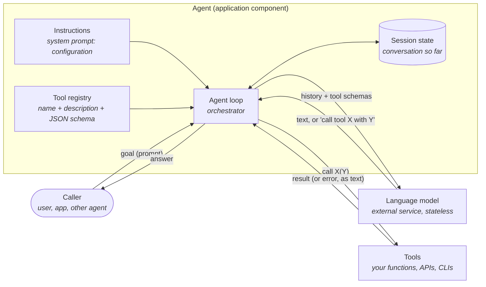
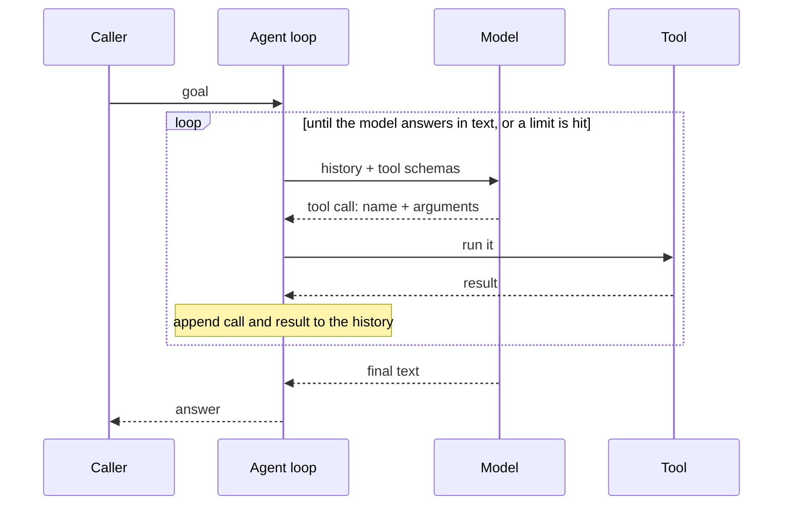

# AWS agent lab

The AWS counterpart of the [Azure Foundry agent lab](https://github.com/avandenberghe/agent-architectures):
the same subject and the same steps, built on Amazon Bedrock and Amazon Bedrock
AgentCore. The point is to separate the agent *pattern*, which is the same
everywhere, from the platform and SDK that carry it.

Built in Python first ([`python/`](python/README.md)). Other languages may follow,
as they did in the Azure lab.

## What an agent is, architecturally

Strip away the products and an agent is a small, specific piece of software: **a
control loop in which the next step is decided by a language model instead of
by your code.** Everything else is a component you already know.

What each box is, in ordinary architecture terms:

| Part | What it is | Who owns it |
|---|---|---|
| **Agent loop** | An orchestrator. Send the history to the model; if the model asks for a tool, run it, append the result, repeat; stop when the model answers in text or a limit is hit. The Azure lab's Java version writes it by hand in about 90 lines, comments included | The framework (Strands, Agent Framework) or the platform (AgentCore harness, Foundry) |
| **Language model** | A stateless remote service: messages in, message out. It never runs anything. It only *proposes* the next step | The provider (Bedrock, Azure OpenAI) |
| **Instructions** | Configuration, not code. They shape what the model proposes but do not enforce anything | You |
| **Tool registry** | A published interface: a name, a description and a JSON schema per tool. That is all the model sees of your code | You (generated from function signatures and docstrings) |
| **Tools** | Adapters to the outside world. Ordinary functions, executed by the loop, never by the model | You |
| **Session state** | The conversation so far. The model has no memory, so whoever keeps this list *is* the memory | Your process (local agent) or the service (published agent) |

The same loop over time:

Three consequences follow from that picture, and they're what the lab steps show:

- **"Local" vs "published" agent is a deployment decision, not a different
  architecture.** In `python/local_agent/` the loop, instructions and session
  live in your process. In `python/agentcore_native/` the same boxes live in
  AgentCore and your process only holds a name and a session ID.
- **The model never acts.** Every side effect happens in a tool your code
  executes. Safety lives there (read-only tools, idempotency keys, limits on
  iterations and tokens), not in the instructions.
- **Instructions are advice.** The Ops step below shows a model that was told
  to check before recommending and didn't. Anything that must happen every time
  belongs in code.

In ArchiMate terms: the agent is an *application component* realising an
*application process* (the loop). The model is an external *application
service* it uses. Each tool is an *application interface* to another component.
The instructions and the session are *data objects*. In C4 terms the agent is a
container, and the model and tools are external systems.

## Azure to AWS

| Azure lab | AWS lab |
|---|---|
| Foundry project in `swedencentral` | AWS account + `eu-north-1` (Stockholm). No project resource: the account is the boundary |
| Model deployment `my-model`, 3K TPM | Nothing to deploy. Models are called on demand through an **inference profile** (`eu.amazon.nova-2-lite-v1:0`); `eu.` keeps requests inside EU regions. Throughput is an account quota |
| `az login`, `AzureCliCredential` | `aws login` (short-lived credentials), read by boto3 through `AWS_PROFILE` |
| Microsoft Agent Framework | [Strands Agents](https://strandsagents.com), AWS's open-source agent framework |
| Published **prompt agent**: named, versioned | **AgentCore harness**: named, immutable versions, named **endpoints** pointing at versions |
| Version chosen per call | Version chosen through an endpoint (`DEFAULT` = latest), like an alias |
| Server-side conversation | `runtimeSessionId`: each session runs in its own microVM |
| Runs under the project's identity | Runs as an **IAM execution role** you create and scope |
| `cleanup.py` deletes the agent | `cleanup.py` deletes the harness *and* the IAM role |

### Why not Bedrock Agents

AWS's original managed agents, Amazon Bedrock Agents (2023), became **Bedrock
Agents Classic** on 30 July 2026: maintenance mode, closed to accounts without
earlier usage (`CreateAgent` returns 403), model catalogue frozen. AWS points new
work to the AgentCore harness, which is what this lab uses. See [Bedrock Agents
Classic maintenance mode](https://docs.aws.amazon.com/bedrock/latest/userguide/agents-classic-maintenance-mode.html).

### AgentCore in one paragraph

AgentCore is AWS's platform for running agents. The **harness** is the
declarative option: you declare model, instructions and tools, and AWS runs the
loop (Strands, inside the service). **Runtime** is the code option: you deploy
your own agent code, in any framework, and AWS hosts it. Around both sit
**Memory**, **Gateway** (APIs and Lambdas exposed as MCP tools), **Identity**,
**Observability**, **Policy**, built-in **Browser** and **Code Interpreter**
tools, and more. The harness is itself built on Runtime: every session is a
Firecracker microVM with a shell and a filesystem, which is why the lab switches
those tools off.

## Setup

1. An AWS account and the AWS CLI v2. Sign in with
   `aws login --profile <profile>`; nothing long-lived is stored.
2. Copy `.env.example` to `.env` and fill in the profile.
3. New accounts: AWS verifies an account before allowing model calls
   ("Your account is currently being verified", usually under 2 hours).
4. Model access: Amazon models work out of the box. Anthropic and some other
   providers need their terms accepted in the Bedrock console first; until then
   they show `agreementAvailability: NOT_AVAILABLE`.

Then follow [`python/README.md`](python/README.md).

## Costs

Prices for `eu-north-1`, from the AWS Pricing API on 2026-10-28. Token counts
measured on lab runs with Nova 2 Lite.

**What is billed, and when**

| What | Price | Billed when |
|---|---|---|
| Nova 2 Lite input tokens | $0.000363 per 1K | every model call |
| Nova 2 Lite output tokens | $0.002992 per 1K | every model call |
| AgentCore Runtime CPU (harness sessions) | $0.0895 per vCPU-hour | only while the session's microVM is actually using CPU; not while waiting on the model |
| AgentCore Runtime memory (harness sessions) | $0.00945 per GB-hour | from microVM start until it shuts down, idle time included |
| AgentCore Memory | $1.00 per GB ingested, plus storage and retrieval | only if memory is enabled; the lab disables it |
| The harness itself, its versions and endpoints, the IAM role | free | — |

There is no charge per agent, per agent call or per idle harness. A published
harness that nobody invokes costs nothing.

**Per lab run (measured)**

| Step | Model calls | Input tokens | Output tokens | Cost |
|---|---|---|---|---|
| `hello_agent.py` | 1 | 62 | 134 | $0.0004 |
| `order_agent.py` | 2 | 2,028 | 70 | $0.0009 |
| `ops_agent.py` | 3 | 5,604 | 232 | $0.0027 |
| `run_agent.py` (two turns, estimate) | 2 + | ~1,000 | ~150 | ~$0.001 tokens + microVM memory: about $0.0008 per GB of session memory, held for the 5-minute idle tail |

Two things the table shows:

- **Tools cost input tokens, not output.** Order sends 2,028 input tokens for a
  two-sentence answer, because each model call resends the instructions, the
  history and the tool schemas. Ops makes three calls and the history grows each
  round. An agent loop is priced by its *input*.
- **The idle tail is the harness's hidden cost.** A session's microVM keeps
  billing memory until `idleRuntimeSessionTimeout` expires. The default is 15
  minutes; the lab sets 5.

**Compared with the Azure lab**

| | Azure Foundry | AWS |
|---|---|---|
| Declarative agent (prompt agent / harness) | No charge for the agent; pay model tokens per call, plus tools | No charge for the harness; pay model tokens, **plus** microVM CPU and memory per session |
| Code-hosted agent (hosted agent / AgentCore Runtime) | vCPU-hours + GiB-hours of container compute | vCPU-hours + GB-hours of microVM compute |
| Model capacity | A deployment with a TPM limit (the lab: 3K TPM, hence HTTP 429s) | No deployment; account quotas (Nova 2 Lite: 8M tokens and 200 requests per minute out of the box) |

The structural difference: a Foundry prompt agent runs on shared service
infrastructure, so you only pay for tokens. An AgentCore harness gives every
session its own microVM with a shell and filesystem, and that VM is billed. For
a lab, both come to fractions of a cent per run. At scale, the AWS
harness bill depends on session count × session lifetime, which the Foundry
prompt agent doesn't have.

Run `cleanup.py --delete` when you're done; it removes the harness and its IAM
role. Nothing else in the lab persists.
